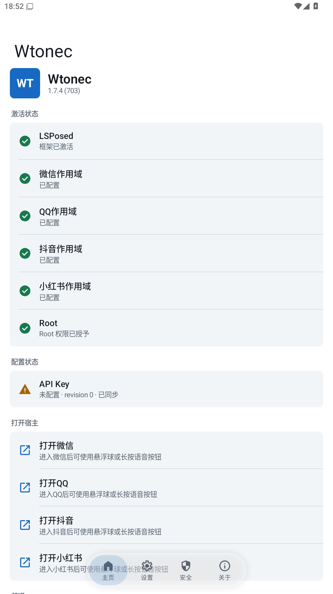
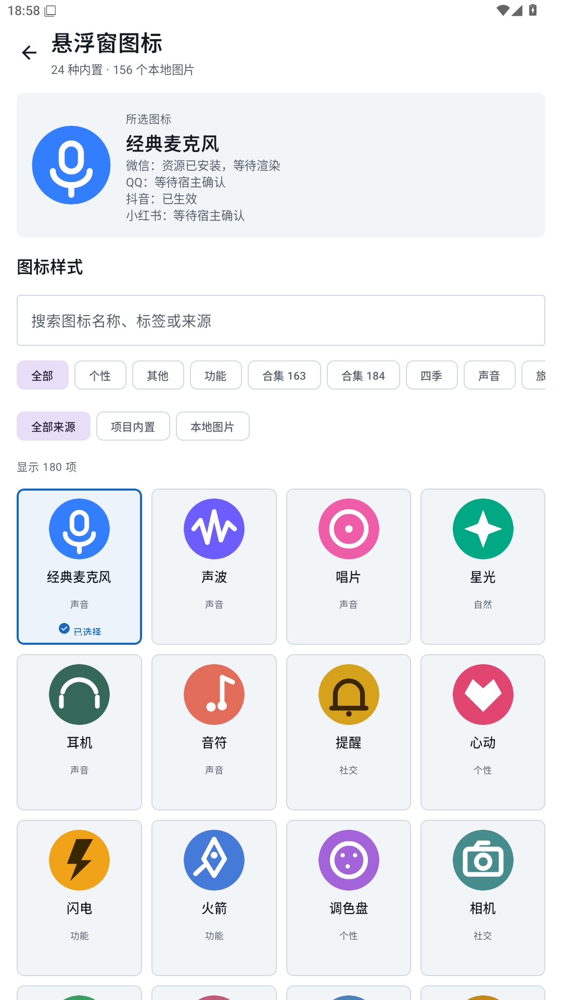
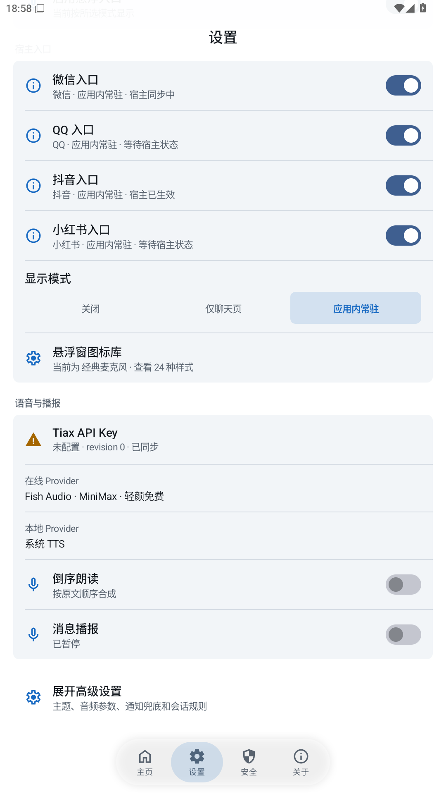
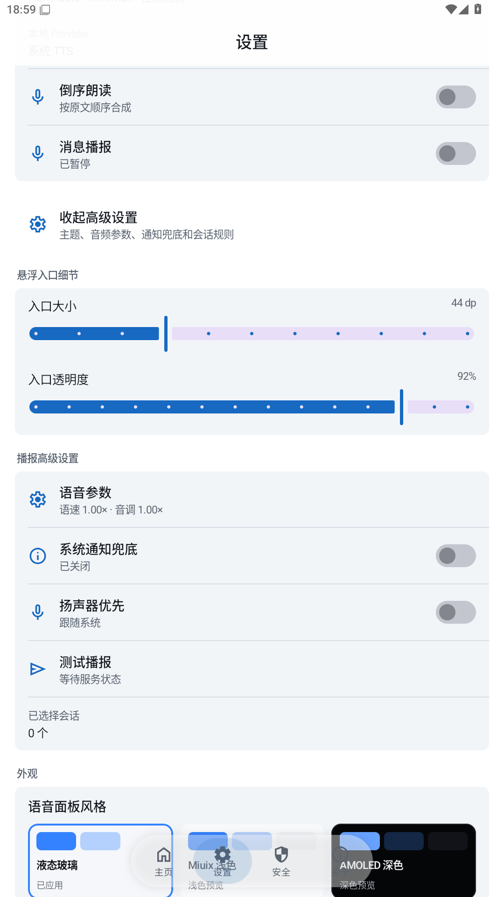

# Wtonec

**微信 / QQ / 小红书 / 抖音的语音与表情包工具：把文字变成语音，在聊天中轻松使用。**

支持文字转语音、语音包、语音播报、克隆音色、表情包等功能，上百款音色可选。**所有音色和功能均免费使用，无需充值。**

[⬇ 下载 1.7.5](https://github.com/tianxing226/wtonec/releases/tag/v1.7.5) · [官网](https://tianxing226.github.io/wtonec/) · [简单使用教程](docs/QUICK_TUTORIAL.md) · [原使用教程](http://i8c.cn/VpGwB)

## 有哪些功能

- **文字转语音**：选择喜欢的音色，输入文字，试听后生成并发送。
- **语音包**：导入、收藏、管理常用语音，聊天时快速发送。
- **语音播报**：按设置朗读通知消息。
- **克隆音色**：创建或使用自己的克隆音色。
- **表情包**：管理常用表情，在私聊和群聊中使用。
- **个性化面板**：液态玻璃、多种主题、悬浮球和自定义图标。

## 1.7.5 更新一览

1. 表情包分为「在线 / 本地」，统一使用紧凑三列图片网格，点击图片直接发送。
2. 新增斗了个图、发表情两个在线来源，支持合集、加载更多和图片缓存；本地导入、收藏和删除继续保留。
3. 修复微信静态图片、GIF 和抖音图片已发出却提示回执超时的问题。
4. 小红书新增适配 **9.50.0（9500803）**，保留 **9.49.1（9491803）**；抖音适配 **40.7.0（400701）**。
5. 优化在线/本地切换栏，增强液态玻璃的折射和边缘高光。

斗了个图支持关键词搜索；发表情遵循网站公开规则，仅筛选已加载内容，不提供全站搜索。

## 软件演示

以下保留 1.7.4 的 MuMu 界面截图，供功能入口参考。

  
  
  
  

## 简单使用教程

1. **安装并启用：**准备 Android 9+ 和已配置的 LSPosed/Xposed，下载 APK 安装；启用 Wtonec，勾选要使用的应用。
2. **打开悬浮窗：**使用抖音、小红书时，先到 Wtonec「设置」开启对应应用的悬浮窗入口。
3. **进入聊天：**完全关闭并重启对应应用，按提示完成匹配；进入私聊或群聊，点击悬浮球打开面板。
4. **选音色、输文字：**在线音色按提示保存自己的 API Key；想先试用可选择无需 Key 的系统 TTS。
5. **试听并发送：**试听满意后，确认当前聊天对象，再点击「生成并发送」。

语音包：导入或选择音频 → 试听 → 发送。表情包：先确认当前聊天 → 选择「在线 / 本地」→ 单击图片直接发送，长按本地图片管理。

**[查看完整的简单教程：安装、开面板、发语音及常见问题 →](docs/QUICK_TUTORIAL.md)**

**抖音、小红书必须先在 Wtonec「设置」页面开启对应应用的悬浮窗入口，才能在聊天页点击悬浮球使用。**

**升级提示：**从 1.7.4（`dev.wtonec.final`）升级可直接覆盖安装，保留原有设置和素材，无需卸载。更早的不同包名版本请先导出重要语音，再启用新版、停用旧模块。

小红书适配 **9.49.1、9.50.0**，抖音适配 **40.7.0**；其他版本请自行测试。完整安装步骤见[快速入门](docs/GETTING_STARTED.md)，文件校验见[更新说明](docs/RELEASE_1.7.5.md)。

## 数据与配置

- 模块配置：`/data/user/0/dev.wtonec.final/shared_prefs/` 与 `files/wtonec_shared_bridge/`。
- 共享表情：`/data/user/0/dev.wtonec.final/files/wtonec/shared-stickers/`。
- 共享语音：`/storage/emulated/0/Android/data/dev.wtonec.final/files/Wtonec/voices/`。

各宿主的配置、素材、缓存与备份注意事项见 **[数据与配置目录](docs/DIRECTORIES.md)**。

## 链接与说明

- [GitHub 发布仓库](https://github.com/tianxing226/wtonec) · [Xposed 模块仓库](https://github.com/Xposed-Modules-Repo/dev.wtonec)
- [使用文档](docs/README.md) · [常见问题](docs/TROUBLESHOOTING.md) · [隐私说明](docs/PRIVACY.md)

本仓库用于发布安装包、说明文档和演示图片。本次更新不包含应用源码、签名私钥、API Key 或私人备份。

本项目与微信、QQ、小红书、抖音官方无隶属关系。请遵守平台规则，并在分享截图或日志前遮盖账号、聊天内容和密钥。
